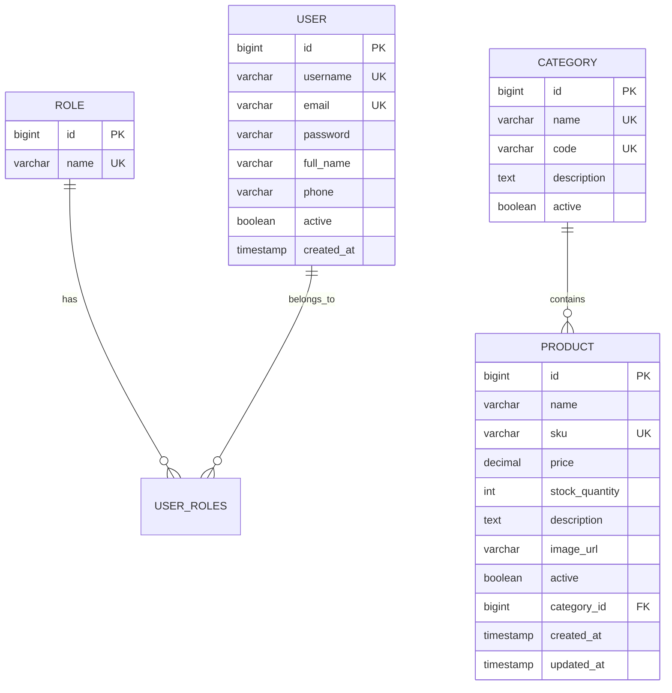

# BÀI TẬP THỰC HÀNH TỔNG HỢP CUỐI KỲ
## HỆ THỐNG BACKEND RESTFUL WEB SERVICES: NỀN TẢNG THƯƠNG MẠI ĐIỆN TỬ TECHMART ENTERPRISE
**Học phần:** Java Web Services & Spring Boot 3  
**Thời lượng đề xuất:** 15 - 20 giờ làm việc độc lập  
**Mục tiêu:** Tích hợp toàn diện kiến thức từ Session 01 đến Session 11 thành một sản phẩm Backend chuẩn Production  

---

## 1. MỤC TIÊU KIẾN THỨC ĐẠT ĐƯỢC

Sau khi hoàn thành bài tập tổng hợp này, sinh viên sẽ làm chủ trọn vẹn các năng lực kỹ thuật sau:

1. **Kiến trúc ứng dụng & Quản trị Bean (Session 01):**
   - Hiểu sâu sắc mô hình Client - Server, luồng điều hướng của Front Controller `DispatcherServlet` trong Spring Boot 3.
   - Làm chủ nguyên lý Inversion of Control (IoC) và cơ chế Dependency Injection (DI) thông qua Constructor Injection chuẩn mực.
   - Khởi tạo và cấu hình dự án đa môi trường với Spring Boot Starter và `application.properties`/`application.yml`.

2. **Tiêu chuẩn thiết kế RESTful Web Services & 3-Tier Layering (Session 02):**
   - Thiết kế hệ thống URI Endpoint chuẩn RESTful: sử dụng danh từ số nhiều, biểu diễn mối quan hệ tài nguyên phân cấp (`/categories/{id}/products`), tuyệt đối không dùng động từ trên URI.
   - Ứng dụng chính xác các HTTP Methods (`GET`, `POST`, `PUT`, `DELETE`) gắn liền với các mã trạng thái HTTP chuẩn mực (`200 OK`, `201 Created`, `204 No Content`, `400 Bad Request`, `401 Unauthorized`, `403 Forbidden`, `404 Not Found`, `409 Conflict`, `500 Internal Server Error`).
   - Phân định rõ ràng trách nhiệm của mô hình 3 lớp: `@RestController` (giao tiếp), `@Service` (xử lý nghiệp vụ & quản trị Transaction), `@Repository` (truy xuất dữ liệu).

3. **Ánh xạ Quan Hệ Cơ Sở Dữ Liệu ORM & Hibernate 6 (Session 04):**
   - Nắm vững 4 trạng thái vòng đời của Entity (Transient, Managed, Detached, Removed) và cơ chế tự động đồng bộ Dirty Checking.
   - Thiết kế ánh xạ quan hệ bảng cơ sở dữ liệu thực tế: Quan hệ 1 - N (@OneToMany / @ManyToOne) giữa `Category` và `Product`; Quan hệ N - N (@ManyToMany) giữa `User` và `Role`.
   - Cấu hình chuẩn xác `mappedBy`, `FetchType.LAZY` (tránh tải thừa dữ liệu) và `CascadeType`.
   - Triệt tiêu hoàn toàn lỗi tuần hoàn dữ liệu vô tận (`Infinite JSON Recursion / StackOverflowError`) khi chuyển đổi Entity sang JSON bằng DTO hoặc `@JsonIgnoreProperties`.

4. **Kỹ thuật Truy Vấn Nâng Cao, Phân Trang & Sắp Xếp Đa Tiêu Chí (Session 05):**
   - Khai thác sức mạnh của Spring Data JPA với **Derived Query Methods** (phương thức truy vấn tự sinh theo quy ước đặt tên).
   - Tối ưu các bài toán tìm kiếm phức tạp với ngôn ngữ truy vấn hướng đối tượng **JPQL** (`@Query`) kết hợp tham số động.
   - Phân trang dữ liệu khoa học phía máy chủ với `Pageable`, `PageRequest`, `Sort` và đối tượng phản hồi `Page<T>`, tránh tràn bộ nhớ khi cơ sở dữ liệu có hàng triệu bản ghi.

5. **Xác Thực Dữ Liệu (Jakarta Bean Validation) & Chuẩn Hóa Phản Hồi (Session 07):**
   - Thiết lập các ràng buộc bảo vệ toàn vẹn dữ liệu từ tầng tiếp nhận thông qua các Annotation: `@Valid`, `@NotNull`, `@NotBlank`, `@Size`, `@Min`, `@Pattern`, `@Email`.
   - Đóng gói toàn bộ các kết quả trả về của hệ thống theo khuôn mẫu thống nhất quốc tế qua đối tượng Generic `DataResponse<T>` gồm: `statusCode`, `message`, `data`, `timestamp`.

6. **Xử Lý Ngoại Lệ Tập Trung & Quản Trị Tệp Đa Phương Tiện (Session 08):**
   - Xây dựng bộ bắt lỗi toàn cục bằng `@RestControllerAdvice` kết hợp `@ExceptionHandler`, ngăn chặn tuyệt đối việc để lộ dấu vết ngăn xếp (Stack Trace) ra môi trường Production.
   - Tiếp nhận tệp tải lên qua `MultipartFile`, kiểm tra tính an toàn của tệp (kiểm tra MIME Type ảnh JPEG/PNG/WEBP, giới hạn dung lượng $\le 5\text{MB}$) và tích hợp tải lên dịch vụ lưu trữ đám mây Cloudinary CDN hoặc lưu trữ an toàn trên máy chủ.

7. **Bảo Mật Hệ Thống & Kiểm Soát Truy Cập Với Spring Security 6 & JWT (Session 10 & 11):**
   - Nắm rõ sự khác biệt bản chất giữa Xác thực (Authentication - 401) và Phân quyền (Authorization - 403).
   - Cấu hình chuỗi bộ lọc bảo mật `SecurityFilterChain` theo kiến trúc phi trạng thái (Stateless Session) và vô hiệu hóa CSRF cho REST API.
   - Mã hóa mật khẩu người dùng một chiều an toàn bằng thuật toán băm công nghiệp `BCryptPasswordEncoder`.
   - Triển khai toàn diện cơ chế xác thực Token Stateless với JSON Web Token (JWT):
     - Sinh Token kèm thời gian sống (TTL), Claims vai trò (`roles`) và khóa bí mật (`SECRET_KEY`).
     - Viết bộ lọc chặn `OncePerRequestFilter` để bóc tách Bearer Token từ Header `Authorization`, giải mã, xác minh tính toàn vẹn của chữ ký điện tử (Signature) và nạp quyền hạn vào `SecurityContextHolder`.
     - Phân quyền theo vai trò (Role-based Access Control): Phân định tài nguyên dành cho khách vãng lai (Public), người dùng thông thường (`ROLE_USER`) và quản trị viên (`ROLE_ADMIN`).

---

## 2. MÔ TẢ VỀ BÀI TẬP VÀ YÊU CẦU CHI TIẾT

### 2.1. Bối Cảnh Nghiệp Vụ
Bạn được giao trọng trách phát triển hệ sinh thái Backend RESTful Web Services cho hệ thống **TechMart Enterprise** - nền tảng thương mại điện tử chuyên cung cấp thiết bị công nghệ cao. Hệ thống yêu cầu khả năng vận hành ổn định, bảo mật chặt chẽ, tối ưu hiệu năng tìm kiếm danh mục sản phẩm và quản lý xác thực tập trung.

---

### 2.2. Yêu Cầu Kiến Trúc Kỹ Thuật (Architecture & Tech Stack)
- **Ngôn ngữ:** Java 17 (LTS) hoặc Java 21 (LTS).
- **Framework nền tảng:** Spring Boot 3.2.x (hoặc 3.3.x).
- **Quản lý phụ thuộc:** Apache Maven hoặc Gradle.
- **Cơ sở dữ liệu:** MySQL 8.0 (hoặc MariaDB / PostgreSQL).
- **ORM & Data Access:** Spring Data JPA, Hibernate 6.
- **Bảo mật:** Spring Security 6, JWT (thư viện `jjwt-api: 0.12.5`, `jjwt-impl`, `jjwt-jackson`).
- **Xác thực dữ liệu:** `spring-boot-starter-validation` (Jakarta Validation).
- **Xử lý ảnh:** Cloudinary SDK (`com.cloudinary:cloudinary-http44:1.36.0`) hoặc Local Storage Service.
- **Công cụ kiểm thử:** Postman, cURL.

---

### 2.3. Thiết Kế Cơ Sở Dữ Liệu & Thực Thể (Database & Entities)

Hệ thống bao gồm tối thiểu 4 thực thể chính:



#### Chi tiết cấu hình Entity JPA:
1. **Entity `Role` (`roles`):**
   - `id`: Khóa chính tự tăng (`@Id`, `@GeneratedValue(strategy = GenerationType.IDENTITY)`).
   - `name`: Tên vai trò duy nhất (`@Column(unique = true, nullable = false, length = 50)`), nhận 2 giá trị Enum: `ROLE_USER`, `ROLE_ADMIN`.
2. **Entity `User` (`users`):**
   - `id`: Khóa chính tự tăng.
   - `username`: Tên đăng nhập duy nhất (`unique = true, nullable = false, length = 50`).
   - `email`: Địa chỉ email duy nhất (`unique = true, nullable = false, length = 100`).
   - `password`: Mật khẩu đã được mã hóa bằng BCrypt (`nullable = false`).
   - `fullName`: Họ và tên người dùng.
   - `phone`: Số điện thoại liên hệ.
   - `active`: Trạng thái kích hoạt tài khoản (mặc định `true`).
   - `roles`: Quan hệ nhiều - nhiều `@ManyToMany(fetch = FetchType.EAGER)` với bảng `Role` thông qua bảng trung gian `user_roles` (`user_id`, `role_id`).
   - `createdAt`: Tự động gán thời gian khởi tạo (`@CreationTimestamp`).
3. **Entity `Category` (`categories`):**
   - `id`: Khóa chính tự tăng.
   - `name`: Tên danh mục duy nhất (`unique = true, nullable = false, length = 100`).
   - `code`: Mã định danh ngắn (`unique = true, nullable = false, length = 50`), ví dụ: `LAPTOP`, `SMARTPHONE`, `ACCESSORIES`.
   - `description`: Mô tả chi tiết danh mục.
   - `active`: Trạng thái hoạt động (mặc định `true`).
   - `products`: Quan hệ `@OneToMany(mappedBy = "category", cascade = CascadeType.ALL, fetch = FetchType.LAZY)`. Cần chú ý dùng DTO hoặc `@JsonIgnore` để không bị lặp tuần hoàn JSON.
4. **Entity `Product` (`products`):**
   - `id`: Khóa chính tự tăng.
   - `name`: Tên sản phẩm (`nullable = false, length = 200`).
   - `sku`: Mã quản lý kho hàng duy nhất (`unique = true, nullable = false, length = 50`), ví dụ: `MBP-M3-16GB`.
   - `price`: Giá bán sản phẩm kiểu `BigDecimal` (`nullable = false`).
   - `stockQuantity`: Số lượng tồn kho kiểu `Integer` (`nullable = false`).
   - `description`: Mô tả thông số kỹ thuật sản phẩm.
   - `imageUrl`: Đường dẫn URL ảnh sản phẩm (HTTPS).
   - `category`: Quan hệ `@ManyToOne(fetch = FetchType.LAZY)`, khóa ngoại `@JoinColumn(name = "category_id", nullable = false)`.
   - `createdAt`, `updatedAt`: Thời điểm tạo và cập nhật gần nhất (`@CreationTimestamp`, `@UpdateTimestamp`).

---

### 2.4. Danh Sách Endpoints & Phân Quyền Chi Tiết (API Specification)

Toàn bộ hệ thống tuân thủ tiền tố URL: `/api/v1`

| STT | HTTP Method | Endpoint URI | Chức Năng Nghiệp Vụ | Phân Quyền Truy Cập | Yêu Cầu Đầu Vào / Query Params | Mã HTTP Trả Về |
|:---:|:-----------:|:-------------|:-------------------|:--------------------|:------------------------------|:---------------|
| **I** | **MODULE AUTH (Xác thực & Cấp phát JWT)** | | | | | |
| 1 | `POST` | `/api/v1/auth/register` | Đăng ký tài khoản người dùng mới | **Public** (Không cần token) | `RegisterRequest` (username, email, password, fullName, phone) | `201 Created` / `400 Bad Request` / `409 Conflict` |
| 2 | `POST` | `/api/v1/auth/login` | Xác thực đăng nhập & nhận JWT | **Public** | `LoginRequest` (username, password) | `200 OK` (trả về JWT Token) / `401 Unauthorized` |
| 3 | `GET` | `/api/v1/auth/me` | Lấy thông tin tài khoản đang đăng nhập | **Authenticated** (`USER`, `ADMIN`) | Header: `Authorization: Bearer <token>` | `200 OK` / `401 Unauthorized` |
| **II** | **MODULE CATEGORY (Quản lý Danh mục)** | | | | | |
| 4 | `GET` | `/api/v1/categories` | Lấy toàn bộ danh mục hoạt động | **Public** | Không | `200 OK` |
| 5 | `GET` | `/api/v1/categories/{id}` | Xem chi tiết 1 danh mục theo ID | **Public** | PathVariable `id` | `200 OK` / `404 Not Found` |
| 6 | `POST` | `/api/v1/categories` | Tạo mới một danh mục | **ROLE_ADMIN** | `CategoryCreateRequest` (@NotBlank name, code) | `201 Created` / `400 Bad Request` / `403 Forbidden` |
| 7 | `PUT` | `/api/v1/categories/{id}` | Cập nhật thông tin danh mục | **ROLE_ADMIN** | PathVariable `id`, `CategoryUpdateRequest` | `200 OK` / `400` / `403` / `404` |
| 8 | `DELETE` | `/api/v1/categories/{id}` | Xóa mềm hoặc xóa hẳn danh mục | **ROLE_ADMIN** | PathVariable `id` | `204 No Content` / `403` / `404` |
| **III**| **MODULE PRODUCT (Quản lý Sản phẩm, Lọc & Phân trang)** | | | | | |
| 9 | `GET` | `/api/v1/products` | Lấy danh sách sản phẩm phân trang cơ bản | **Public** | Query params: `page=0&size=10&sortBy=id&direction=desc` | `200 OK` (Trả về đối tượng `PageResponse`) |
| 10 | `GET` | `/api/v1/products/{id}` | Xem chi tiết sản phẩm theo ID | **Public** | PathVariable `id` | `200 OK` / `404 Not Found` |
| 11 | `GET` | `/api/v1/products/search` | **Tìm kiếm nâng cao:** Lọc theo keyword (tên/mô tả), khoảng giá (minPrice, maxPrice), danh mục (categoryId), kèm phân trang & sắp xếp động | **Public** | Params: `keyword`, `minPrice`, `maxPrice`, `categoryId`, `page`, `size`, `sortBy`, `direction` | `200 OK` (Trả về danh sách phân trang chuẩn) |
| 12 | `POST` | `/api/v1/products` | Tạo mới sản phẩm | **ROLE_ADMIN** | `ProductCreateRequest` (Name, SKU, Price, Stock, CategoryId) | `201 Created` / `400 Bad Request` / `403 Forbidden` / `404 Category Not Found` |
| 13 | `PUT` | `/api/v1/products/{id}` | Cập nhật thông tin sản phẩm | **ROLE_ADMIN** | PathVariable `id`, `ProductUpdateRequest` | `200 OK` / `400` / `403` / `404` |
| 14 | `DELETE` | `/api/v1/products/{id}` | Xóa sản phẩm khỏi kho | **ROLE_ADMIN** | PathVariable `id` | `204 No Content` / `403` / `404` |
| 15 | `POST` | `/api/v1/products/{id}/image` | **Upload ảnh sản phẩm:** Tải tệp ảnh đại diện lên Cloudinary và cập nhật `imageUrl` | **ROLE_ADMIN** | Form-data: `file` (MultipartFile) | `200 OK` (Trả về URL ảnh HTTPS) / `400` / `403` / `404` |

---

### 2.5. Yêu Cầu Kỹ Thuật Chi Tiết Cho Từng Tầng

#### Tầng 1: Data Binding & Jakarta Bean Validation
Sinh viên phải gắn các Annotation ràng buộc nghiêm ngặt trên tất cả các DTO Request:
- `RegisterRequest`:
  - `username`: `@NotBlank(message = "Username không được để trống")`, `@Size(min = 4, max = 50, message = "Username phải từ 4 đến 50 ký tự")`.
  - `email`: `@NotBlank`, `@Email(message = "Định dạng Email không hợp lệ")`.
  - `password`: `@NotBlank`, `@Size(min = 6, message = "Mật khẩu tối thiểu phải từ 6 ký tự")`.
  - `phone`: `@Pattern(regexp = "^(0|\\+84)[3|5|7|8|9][0-9]{8}$", message = "Số điện thoại di động Việt Nam không đúng định dạng")`.
- `ProductCreateRequest`:
  - `name`: `@NotBlank(message = "Tên sản phẩm không được rỗng")`, `@Size(max = 200)`.
  - `sku`: `@NotBlank(message = "Mã SKU bắt buộc phải có")`, `@Pattern(regexp = "^[A-Z0-9_-]{3,20}$", message = "Mã SKU chỉ gồm chữ in hoa, chữ số, gạch nối và gạch dưới")`.
  - `price`: `@NotNull(message = "Giá sản phẩm không được null")`, `@Min(value = 1000, message = "Giá sản phẩm tối thiểu là 1,000 VND")`.
  - `stockQuantity`: `@NotNull`, `@Min(value = 0, message = "Số lượng tồn kho không được âm")`.
  - `categoryId`: `@NotNull(message = "Sản phẩm bắt buộc phải thuộc về 1 danh mục")`.

#### Tầng 2: Chuẩn Hóa Response & Global Exception Handler
Tất cả các Endpoint khi trả về dữ liệu (kể cả thành công hay thất bại) đều phải được bọc trong lớp Generic:
```java
public class DataResponse<T> {
    private int status;
    private String message;
    private T data;
    private LocalDateTime timestamp;
    // constructors, getters, setters
}
```
Lớp `@RestControllerAdvice` phải xử lý triệt để các ngoại lệ sau:
1. `MethodArgumentNotValidException`: Trả về `400 Bad Request` kèm theo cấu trúc Map chứa danh sách các trường bị vi phạm (`Map<String, String> fieldErrors`).
2. `ResourceNotFoundException`: Trả về `404 Not Found` kèm thông điệp cụ thể (ví dụ: *"Không tìm thấy sản phẩm có ID: 99"*).
3. `DuplicateResourceException`: Trả về `409 Conflict` (ví dụ: *"Tên đăng nhập hoặc mã SKU đã tồn tại"*).
4. `BadCredentialsException`: Trả về `401 Unauthorized` (ví dụ: *"Tên đăng nhập hoặc mật khẩu không chính xác"*).
5. `AccessDeniedException`: Trả về `403 Forbidden` (ví dụ: *"Bạn không có quyền truy cập chức năng này"*).
6. `MaxUploadSizeExceededException`: Trả về `400 Bad Request` (ví dụ: *"Kích thước tệp vượt quá giới hạn cho phép (tối đa 5MB)"*).
7. `Exception`: Bắt tất cả các lỗi không lường trước, ghi log server và trả về `500 Internal Server Error` với thông điệp an toàn.

#### Tầng 3: Tối Ưu Truy Vấn & Phân Trang Đa Tiêu Chí
Tại `ProductRepository`, bắt buộc phải cài đặt phương thức JPQL truy vấn đa điều kiện hỗ trợ tìm kiếm linh hoạt:
```java
@Query("SELECT p FROM Product p WHERE " +
       "(:keyword IS NULL OR LOWER(p.name) LIKE LOWER(CONCAT('%', :keyword, '%')) OR LOWER(p.description) LIKE LOWER(CONCAT('%', :keyword, '%'))) AND " +
       "(:minPrice IS NULL OR p.price >= :minPrice) AND " +
       "(:maxPrice IS NULL OR p.price <= :maxPrice) AND " +
       "(:categoryId IS NULL OR p.category.id = :categoryId) AND " +
       "(p.active = true)")
Page<Product> searchProducts(
    @Param("keyword") String keyword,
    @Param("minPrice") BigDecimal minPrice,
    @Param("maxPrice") BigDecimal maxPrice,
    @Param("categoryId") Long categoryId,
    Pageable pageable
);
```

#### Tầng 4: Bộ Lọc Bảo Mật & Pipeline Upload Tệp
- Tích hợp `JwtAuthenticationFilter` (kế thừa `OncePerRequestFilter`) để kiểm tra `Authorization: Bearer <token>`. Nếu hợp lệ, giải mã Username, trích xuất quyền (`Authorities`), thiết lập vào `SecurityContextHolder.getContext().setAuthentication(auth)`.
- Khi tải lên tệp ảnh qua API `POST /api/v1/products/{id}/image`:
  - Kiểm tra xem tệp có rỗng (`file.isEmpty()`) hay không.
  - Kiểm tra Content-Type: Chỉ chấp nhận `image/jpeg`, `image/png`, `image/webp`.
  - Nếu tệp hợp lệ $\rightarrow$ tải lên Cloudinary (hoặc thư mục `uploads/`), lấy URL trả về cập nhật vào trường `imageUrl` của `Product` trong cơ sở dữ liệu.

---

## 3. KẾT QUẢ MONG MUỐN (DELIVERABLES & ACCEPTANCE CRITERIA)

### 3.1. Cấu Trúc Thư Mục Dự Án Chuẩn Mực
Dự án phải được tổ chức khoa học theo mô hình phân tầng hướng gói (Package-by-Feature hoặc Package-by-Layer):

```
techmart-backend/
├── src/
│   ├── main/
│   │   ├── java/com/techmart/
│   │   │   ├── config/              # SecurityConfig, CloudinaryConfig, ApplicationConfig
│   │   │   ├── controller/          # AuthController, CategoryController, ProductController
│   │   │   ├── dto/
│   │   │   │   ├── request/         # RegisterRequest, LoginRequest, ProductFilterRequest...
│   │   │   │   └── response/        # DataResponse, JwtResponse, ProductResponse, PageResponse...
│   │   │   ├── entity/              # User, Role, Category, Product, RoleName (Enum)
│   │   │   ├── exception/           # Custom Exceptions & GlobalExceptionHandler
│   │   │   ├── repository/          # UserRepository, RoleRepository, CategoryRepository, ProductRepository
│   │   │   ├── security/            # JwtTokenProvider, JwtAuthenticationFilter, UserDetailsServiceImpl
│   │   │   └── service/             # Interfaces & ServiceImpl (Auth, Category, Product, FileUpload)
│   │   │   └── TechMartApplication.java
│   │   └── resources/
│   │       ├── application.properties (hoặc application.yml)
│   │       └── data.sql (Script khởi tạo dữ liệu mẫu: Role USER/ADMIN, danh mục mặc định)
├── pom.xml (hoặc build.gradle)
├── README.md
├── TechMart_Enterprise.postman_collection.json
└── .gitignore
```

---

### 3.2. Bảng Ma Trận Kịch Bản Kiểm Thử Postman (12 Test Scenarios)

Dự án phải vượt qua 100% các kịch bản kiểm thử sau trên Postman:

| STT | Kịch Bản Kiểm Thử | Endpoint & Method | Điều Kiện Đầu Vào | Kết Quả Mong Đợi (Status & Payload) |
|:---:|:------------------|:------------------|:------------------|:------------------------------------|
| 1 | Đăng ký tài khoản hợp lệ | `POST /api/v1/auth/register` | Dữ liệu đúng chuẩn, role mặc định là `USER` | `201 Created`, data trả về UserResponse (không chứa password) |
| 2 | Đăng ký lỗi Validation | `POST /api/v1/auth/register` | Email sai định dạng, mật khẩu < 6 ký tự | `400 Bad Request`, `errors` chỉ rõ các trường bị vi phạm |
| 3 | Đăng ký trùng Username | `POST /api/v1/auth/register` | Username đã tồn tại trong DB | `409 Conflict`, message thông báo tài khoản đã có người sử dụng |
| 4 | Đăng nhập sai mật khẩu | `POST /api/v1/auth/login` | Password không khớp hash BCrypt | `401 Unauthorized`, message từ chối đăng nhập |
| 5 | Đăng nhập thành công | `POST /api/v1/auth/login` | Username & password chính xác | `200 OK`, trả về chuỗi Bearer Token JWT & thông tin User |
| 6 | Tạo Category không có Token | `POST /api/v1/categories` | Không gửi header `Authorization` | `401 Unauthorized` ngay tại cổng bộ lọc bảo mật |
| 7 | User thường tạo Category | `POST /api/v1/categories` | Token của tài khoản có role `ROLE_USER` | `403 Forbidden` (chỉ `ROLE_ADMIN` mới có quyền tạo) |
| 8 | Admin tạo Category | `POST /api/v1/categories` | Token của tài khoản `ROLE_ADMIN` | `201 Created`, trả về thông tin Category mới |
| 9 | Admin tạo Product vi phạm giá | `POST /api/v1/products` | Token Admin, nhưng trường `price = -50000` | `400 Bad Request`, bắt lỗi bởi Jakarta Bean Validation |
| 10| Admin tạo Product thành công | `POST /api/v1/products` | Token Admin, đầy đủ trường & CategoryId chuẩn | `201 Created`, tạo thành công sản phẩm mới |
| 11| Tìm kiếm & Phân trang nâng cao | `GET /api/v1/products/search?keyword=dell&minPrice=10000000&page=0&size=5&sortBy=price&direction=asc` | Không cần Token (Public) | `200 OK`, trả về danh sách sản phẩm khớp điều kiện được sắp xếp giá tăng dần kèm metadata phân trang |
| 12| Upload ảnh sản phẩm vượt dung lượng | `POST /api/v1/products/{id}/image` | Tệp ảnh dung lượng > 5MB hoặc file đuôi `.exe` | `400 Bad Request`, bắt lỗi tệp không hợp lệ hoặc dung lượng vượt ngưỡng |

---

### 3.3. Thang Điểm Đánh Giá Nghiệm Thu (Rubric Chấm Điểm - Thang 10)

| Tiêu Chí | Trọng Số | Mô Tả Yêu Cầu Đạt Điểm Tối Đa |
|:---|:---:|:---|
| **1. Cấu trúc dự án & Mã nguồn Clean Code** | **1.0 đ** | Phân tầng 3-tier rành mạch, tuân thủ Java Naming Conventions, Constructor Injection cho mọi Bean, không thừa import/comment rác. |
| **2. Thiết kế Database & Ánh xạ JPA Entity** | **1.5 đ** | Đầy đủ 4 Entity, cấu hình quan hệ 1-N và N-N chuẩn xác, không bị đệ quy vô tận JSON, sử dụng đúng kiểu dữ liệu (BigDecimal cho tiền tệ). |
| **3. Chuẩn hóa REST API & Status Codes** | **1.5 đ** | URI chuẩn danh từ số nhiều, đúng HTTP Methods, phân bổ chính xác các mã trạng thái (200, 201, 204, 400, 401, 403, 404, 409). |
| **4. Truy vấn nâng cao, Phân trang & Lọc** | **1.5 đ** | Cài đặt câu lệnh JPQL `@Query` xử lý tìm kiếm nhiều điều kiện mềm dẻo, phân trang `Pageable` và sắp xếp `Sort` không bị lỗi tràn trang. |
| **5. Bean Validation & Global Exception Handling** | **1.5 đ** | Ràng buộc chặt chẽ các trường DTO đầu vào, bắt mọi lỗi tập trung qua `@RestControllerAdvice`, chuẩn hóa phản hồi bằng `DataResponse<T>`. |
| **6. Quản trị Tệp Tin (File Upload)** | **1.0 đ** | Tải ảnh thành công lên Cloudinary hoặc máy chủ, validate đúng định dạng ảnh và dung lượng tệp, liên kết được URL ảnh vào Entity. |
| **7. Bảo mật Spring Security 6 & Xác thực JWT** | **1.5 đ** | Mật khẩu băm BCrypt, Stateless Session, cấp phát JWT hợp lệ, xác minh Bearer Token qua Filter, phân quyền Role-based nghiêm ngặt. |
| **8. Hồ sơ Nộp bài & File Postman Collection** | **0.5 đ** | Có file `README.md` chỉn chu, file `.gitignore` chuẩn, file `postman_collection.json` cấu hình sẵn biến môi trường test được ngay. |

---

## 4. HƯỚNG DẪN NỘP BÀI LÊN GITHUB

Sinh viên bắt buộc phải nộp bài dưới dạng liên kết Kho lưu trữ GitHub (GitHub Repository). Hãy thực hiện tuần tự và chính xác các bước dưới đây để đảm bảo bài nộp chuẩn mực:

---

### Bước 1: Khởi Tạo File `.gitignore` Chuẩn Cho Dự Án Spring Boot
Tuyệt đối **KHÔNG** tải lên GitHub các thư mục mã máy sinh ra trong quá trình biên dịch (như `target/`, `build/`), các file cài đặt IDE cá nhân (`.idea/`, `.vscode/`, `*.iml`), hoặc thông tin nhạy cảm.

Tạo file mang tên `.gitignore` ngay tại thư mục gốc của dự án với nội dung:
```gitignore
# Compiled class file
**/target/
**/build/
*.class

# Log files
*.log

# Package Files
*.jar
*.war
*.nar
*.ear
*.zip
*.tar.gz
*.rar

# Virtual machine crash logs
hs_err_pid*
replay_pid*

# IDE Specific Files
.idea/
.vscode/
*.iml
*.iws
*.ipr
.settings/
.project
.classpath

# Operating System Files
.DS_Store
Thumbs.db

# Sensitive local configurations (nếu có)
application-local.properties
.env
```

---

### Bước 2: Soạn Thảo File `README.md` Cho Dự Án Của Bạn
Tạo file `README.md` tại thư mục gốc của dự án với các thông tin tối thiểu sau:
1. **Thông tin sinh viên:** Họ tên, Mã sinh viên, Lớp, Môn học.
2. **Mô tả đề tài:** Hệ thống Backend TechMart Enterprise RESTful API.
3. **Yêu cầu môi trường:** JDK phiên bản bao nhiêu, MySQL phiên bản nào.
4. **Hướng dẫn cài đặt & Khởi chạy:**
   - Lệnh tạo Database trong MySQL:
     ```sql
     CREATE DATABASE techmart_db CHARACTER SET utf8mb4 COLLATE utf8mb4_unicode_ci;
     ```
   - Lệnh biên dịch và chạy dự án:
     ```bash
     # Nếu dùng Maven Wrapper:
     ./mvnw clean spring-boot:run

     # Nếu dùng Gradle Wrapper:
     ./gradlew bootRun
     ```
5. **Tài khoản kiểm thử mặc định (Seed Data):**
   - Tài khoản Admin: `username: admin`, `password: 123456`
   - Tài khoản User: `username: user`, `password: 123456`
6. **Hướng dẫn sử dụng file Postman Collection đính kèm.**

---

### Bước 3: Xuất File Postman Collection
1. Mở ứng dụng **Postman**.
2. Chuột phải vào Collection chứa 12 kịch bản test của dự án $\rightarrow$ Chọn **Export** $\rightarrow$ Chọn định dạng **Collection v2.1 (recommended)**.
3. Đặt tên file là `TechMart_Enterprise.postman_collection.json` và lưu trực tiếp vào thư mục gốc của dự án dự thi.

---

### Bước 4: Khởi Tạo Git & Đẩy Mã Nguồn Lên GitHub

Mở cửa sổ dòng lệnh Terminal / PowerShell ngay tại thư mục gốc dự án và thực hiện tuần tự các lệnh sau:

```bash
# 1. Khởi tạo Git repository tại máy cục bộ
git init

# 2. Thêm toàn bộ mã nguồn hợp lệ vào khu vực chờ (Staging Area)
git add .

# 3. Tạo commit đầu tiên với thông điệp rõ ràng theo chuẩn Conventional Commits
git commit -m "feat: complete TechMart Enterprise RESTful Backend with Spring Boot 3, JPA, Security and JWT"

# 4. Đổi tên nhánh mặc định thành 'main'
git branch -M main

# 5. Đăng nhập GitHub và tạo 1 New Repository (ví dụ đặt tên: java-web-services-techmart-capstone)
# CHÚ Ý: Đặt chế độ Public (hoặc Private kèm theo việc mời Giảng viên làm Collaborator nếu có yêu cầu)

# 6. Gán liên kết từ xa (thay thế URL bằng link repo thật của bạn)
git remote add origin https://github.com/<your-username>/java-web-services-techmart-capstone.git

# 7. Đẩy toàn bộ mã nguồn lên GitHub
git push -u origin main
```

---

### Bước 5: Kiểm Tra & Nghiệm Thu Trước Khi Nộp
Trước khi copy đường link GitHub gửi lên hệ thống nộp bài (Google Classroom / LMS / Form nộp bài), sinh viên cần kiểm tra kỹ:
- [ ] Mở trình duyệt ẩn danh (Incognito) và truy cập vào link GitHub Repository xem trang có tải được không (đảm bảo không bị lỗi 404 do đặt Private).
- [ ] Kiểm tra xem thư mục `target/` hoặc `.idea/` có vô tình bị đẩy lên không (nếu có, dùng lệnh `git rm -r --cached target/` và commit lại).
- [ ] Kiểm tra file `TechMart_Enterprise.postman_collection.json` đã có mặt trên GitHub hay chưa.
- [ ] Kiểm tra file `README.md` hiển thị đẹp, rõ ràng hướng dẫn chạy dự án.
- [ ] Copy đường dẫn dạng: `https://github.com/<your-username>/<repo-name>` và dán vào form nộp bài theo đúng hạn chót của Học viện.

